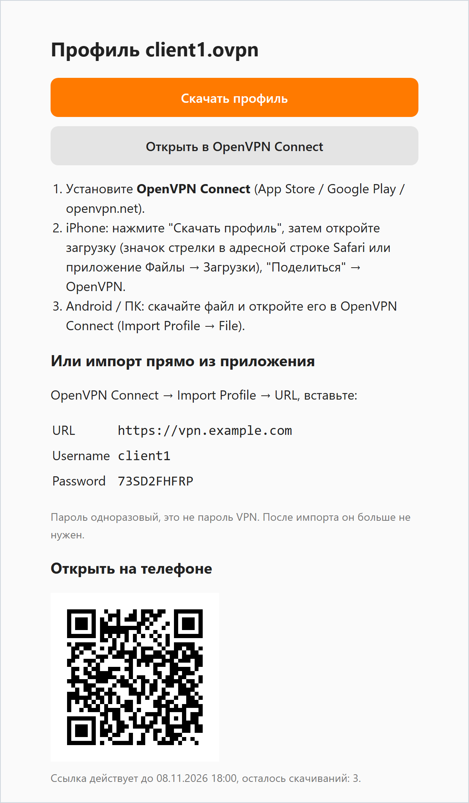

<p align="right"><a href="README.md">Русский</a> · <b>English</b></p>

<h1 align="center">ovpn-sender</h1>

<p align="center">
  OpenVPN Access Server emulation.<br>
  Lets you hand out profiles to an iPhone with a link.
</p>

<p align="center">
  <a href="https://github.com/mikedigriz/ovpn-sender/actions/workflows/docker.yml"></a>
  <a href="https://hub.docker.com/r/mikedigriz/ovpn-sender"></a>
  
  
  <a href="LICENSE"></a>
</p>

<p align="center">
  
</p>

## How it works

1. The admin drops an `.ovpn` into a folder and runs `ovpn add client1.ovpn`. The output has the URL, username, one-time password, a link page and a QR code of that link right in the terminal.
2. In OpenVPN Connect the user taps **+** -> **Import Profile** -> **URL** and enters the URL, username and password. Or scans the QR code and opens the page (pictured above, in Russian).
3. The profile is imported and the password is spent. By default, it lives 24 hours and allows 3 imports.

Works on iPhone, Android, Windows and macOS.

## Features

- a single Python file, standard library only; image based on `python:3.12-alpine`, about 50-60 MB;
- import straight from OpenVPN Connect via the Access Server protocol, no files to pass around;
- one-time passwords with expiry and an import limit, brute-force protection;
- a browser fallback page with a download button and a QR code;
- HTTPS inside the container from ready PEM certificates, or plain HTTP behind your own reverse proxy.

> [!IMPORTANT]
> A valid certificate is required either way: OpenVPN Connect only talks HTTPS and rejects self-signed certificates.

## Contents

- [Quick start: HTTPS in the container](#quick-start-https-in-the-container)
- [Behind your own reverse proxy](#behind-your-own-reverse-proxy)
- [Issuing access](#issuing-access)
- [Environment variables](#environment-variables)
- [Building it yourself](#building-it-yourself)
- [Publishing the image](#publishing-the-image)
- [Protocol](#protocol)
- [Security](#security)

## Quick start: HTTPS in the container

You need a domain pointing at the server (DDNS works) and a certificate for it. If you don't have one yet, get it on the host. Port 80 must be free while certbot runs:

```bash
sudo certbot certonly --standalone -d vpn.example.com
```

The container runs as uid 10001, while Let's Encrypt keys are readable by root only. Grant read access:

```bash
sudo setfacl -R -m u:10001:rX /etc/letsencrypt/live /etc/letsencrypt/archive
```

On renewal certbot creates new files with mode 600, so access has to be granted again. A deploy hook does that:

```bash
printf '#!/bin/sh\nsetfacl -R -m u:10001:rX /etc/letsencrypt/live /etc/letsencrypt/archive\n' | sudo tee /etc/letsencrypt/renewal-hooks/deploy/ovpn-sender && sudo chmod 755 /etc/letsencrypt/renewal-hooks/deploy/ovpn-sender
```

Run:

```bash
docker run -d --name ovpn --restart unless-stopped \
  -p 443:8080 \
  -e OVPN_DOMAIN=vpn.example.com \
  -v /etc/letsencrypt:/etc/letsencrypt:ro \
  -v ovpn-data:/data \
  -v /srv/ovpn/profiles:/profiles:ro \
  mikedigriz/ovpn-sender:latest
```

`OVPN_DOMAIN` loads the certificate from `/etc/letsencrypt/live/<domain>/`. The whole directory is mounted because files in `live/` are symlinks into `archive/`. A renewed certificate is picked up within an hour, no restart needed.

Certificate not from certbot: mount any PEM files and set the paths explicitly:

```bash
-v /path/to/certs:/certs:ro -e OVPN_CERT=/certs/fullchain.pem -e OVPN_KEY=/certs/privkey.pem
```

Next: [issuing access](#issuing-access).

## Behind your own reverse proxy

Without certificates the container serves HTTP on port 8080, and the proxy exposes it.

```bash
git clone https://github.com/mikedigriz/ovpn-sender.git && cd ovpn-sender
cp .env.example .env    # OVPN_BASE_URL, OVPN_HOST_PORT, optionally OVPN_IMAGE
docker compose up -d
```

The proxy needs three paths. An Nginx example is in [nginx/ovpn-sender.conf](nginx/ovpn-sender.conf).

| Path | Upstream | Purpose |
|---|---|---|
| `/rest/` | as is | import: `GET /rest/GetUserlogin` with Basic auth |
| `/openvpn-api/` | as is | Connect probes `/openvpn-api/profile` first |
| `/ovpn/` | prefix stripped | link page for the browser |

- The first two paths must be at the host root: Connect drops the path from the URL you enter.
- The proxy must not replace 401 responses with its own error pages.
- If the proxy blocks clients by User-Agent, allow `Connect/<version>/...` on these paths.
- `OVPN_TRUSTED_PROXIES` lists the proxy addresses whose `X-Real-IP` and `X-Forwarded-For` the backend trusts. A proxy on the host reaches the container through the docker network gateway, hence the compose default `172.16.0.0/12`. Without it, brute-force protection sees every client as one IP. The proxy must overwrite these headers rather than pass through what the client sent.

## Issuing access

Put profiles into the mounted directory (`/srv/ovpn/profiles`, or `./profiles` with compose). They must be readable by uid 10001:

```bash
sudo chmod 644 /srv/ovpn/profiles/*.ovpn
```

New files are picked up without a restart. Issue access:

```bash
docker exec ovpn ovpn add client1.ovpn
```

```
client1.ovpn
  URL:     https://vpn.example.com
  логин:   client1
  пароль:  73SD2FHFRP
  страница: https://vpn.example.com/p/<token>
```

(The CLI output is in Russian: URL, username, password, link page.)

A QR code of the page is printed below these lines, so a phone camera can scan it right off the screen. When the page is opened on a PC, it shows the QR code as well. With compose use `docker compose exec ovpn-sender` instead of `docker exec ovpn`.

| Command | What it does |
|---|---|
| `add [files] [--ttl h] [--max N] [--user name] [--no-qr]` | issue access (`0` - unlimited; no files - all profiles) |
| `qr <file or token prefix>` | show the QR code and data of live access again |
| `list [-a]` | status of issued access. With `-a` - live ones only, with URL, username, password and link |
| `revoke <file or token prefix>` | revoke |
| `cleanup` | drop expired and revoked records |
| `serve`, `health` | server and health check, invoked by the image itself |

Deleting a file from `profiles/` immediately invalidates all access issued for it. An already imported profile keeps working: to cut a client off, revoke its certificate on the VPN server.

## Environment variables

| Variable | Default | Description |
|---|---|---|
| `OVPN_DOMAIN` | empty | enables HTTPS with the certificate from `/etc/letsencrypt/live/<domain>/` and sets the default address |
| `OVPN_CERT`, `OVPN_KEY` | from `OVPN_DOMAIN` | paths to the PEM certificate and key. If neither is set, the server runs plain HTTP |
| `OVPN_BASE_URL` | `https://<OVPN_DOMAIN>` | external address of the link page. Behind a proxy with a prefix, e.g. `https://vpn.example.com/ovpn` |
| `OVPN_TRUSTED_PROXIES` | empty | proxy IPs or subnets, comma-separated |
| `OVPN_PORT` | `8080` | port inside the container |
| `OVPN_PROFILES_DIR` | `/profiles` | where `.ovpn` files are read from |
| `OVPN_DATA_DIR` | `/data` | database of issued access (a volume, survives image updates) |

Compose only (`.env`): `OVPN_HOST_PORT` - port on the host's `127.0.0.1`, `OVPN_IMAGE` - a prebuilt image instead of a local build.

## Building it yourself

<details>
<summary>Docker, Docker Compose, multi-arch, without Docker</summary>

### Docker

```bash
git clone https://github.com/mikedigriz/ovpn-sender.git
cd ovpn-sender
docker build -t ovpn-sender .
```

Then use the same `docker run` as in the quick start, with the local tag `ovpn-sender` instead of `mikedigriz/ovpn-sender:latest`.

### Docker Compose

`compose.yaml` builds the image from source unless `OVPN_IMAGE` is set:

```bash
cp .env.example .env
docker compose up -d --build
```

### Multi-arch into your own registry

```bash
docker buildx create --use
docker buildx build --platform linux/amd64,linux/arm64 -t <user>/ovpn-sender:latest --push .
```

### Without Docker

Python 3.8 or newer, no dependencies.

```bash
mkdir -p profiles data && cp client1.ovpn profiles/
export OVPN_PROFILES_DIR=./profiles OVPN_DATA_DIR=./data OVPN_BASE_URL=https://vpn.example.com
python3 ovpn_sender.py serve --port 8080        # HTTP behind a proxy
python3 ovpn_sender.py add client1.ovpn         # in another terminal, same variables
```

For HTTPS without a proxy add `OVPN_CERT` and `OVPN_KEY` (or `OVPN_DOMAIN`). Port 443 needs root, so listen on 8080 and forward 443 to it with the firewall.

</details>

## Publishing the image

<details>
<summary>GitHub Actions -> Docker Hub for your fork</summary>

The workflow [.github/workflows/docker.yml](.github/workflows/docker.yml) builds the image for `amd64` and `arm64` and pushes it to Docker Hub:

- push to `main` - tag `latest`;
- tag `vX.Y.Z` - tags `X.Y.Z` and `X.Y`.

Setup:

1. Docker Hub -> Account settings -> Personal access tokens -> create a token with Read & Write.
2. GitHub -> Settings -> Secrets and variables -> Actions: add secrets `DOCKERHUB_USERNAME` and `DOCKERHUB_TOKEN`.
3. In the workflow replace `IMAGE: mikedigriz/ovpn-sender` with your own name.

Releasing a version:

```bash
git tag v1.0.0 && git push origin v1.0.0
```

</details>

## Protocol

<details>
<summary>How Connect imports a profile and which requests the server handles</summary>

Following [openvpn-rfc/webauth.md](https://github.com/OpenVPN/openvpn-rfc/blob/master/webauth.md):

1. Connect probes `/openvpn-api/profile`. The backend answers 404 without an `Ovpn-WebAuth` header, so the app shows the Username and Password fields.
2. `GET /rest/GetUserlogin?tls-cryptv2=1&action=import` with Basic auth:
   - valid credentials - 200 `text/plain` with the profile;
   - invalid - 401 and XML `<Error><Type>Authorization Required</Type>...`.

| Request | Description |
|---|---|
| `GET/POST /rest/GetUserlogin`, `GetAutologin`, `GetGeneric` | Basic auth: username from `add` and the one-time password, case-insensitive |
| `/rest/GetProfileViaToken?token=<token>` | `openvpn://import-profile/...` token link from the page, no password |
| `/p/<token>` | browser page |

Requests were captured from OpenVPN Connect 3.7 (Android) and 3.9 (Windows): the path is dropped from the URL, the User-Agent looks like `Connect/<version>/<platform>`.

</details>

## Security

- An `.ovpn` usually contains the client's private key. A link or a password equals VPN access, hence the defaults: 24 hours and 3 imports. Every import, by any method, uses one up.
- The `/p/<token>` link is a full key: the page shows the password and offers a direct download. The QR code holds the same link. Send it over a trusted channel. Importing via the app needs no link, only the URL, username and password.
- The password is 10 characters from a 32-character alphabet (about 50 bits). After 10 wrong attempts from one IP within 15 minutes the server answers 429.
- Only `*.ovpn` files from `/profiles` are served, names with paths are rejected.
- TLS 1.2 or newer. The TLS handshake runs in the handler thread with a 30-second timeout, so a silent client does not block the server.
- The server is built on the standard library `http.server`, which is not designed for a flood of hostile connections. On the open internet under load, put a reverse proxy with connection limits in front of the container.
- `/data/tokens.json` keeps an import log (time, IP, User-Agent). Tokens are masked in the server log.
- The container runs as uid 10001. Compose also enables a read-only FS, `cap_drop: ALL` and a 64 MB memory limit; the same flags can be added to `docker run`.

## License

[MIT](LICENSE)
